  

  Emprendedor desde 2013. Construyo apps, automatizaciones con IA, marcas y música. 
  No soy developer de oficio. Soy de los que inventan algo y aprenden lo necesario para hacerlo existir.

  <a href="https://parlandoapp.com">🎙️ Parlando</a> ·
  <a href="https://github.com/srjaner-oss/parlando-web">📂 Repo de Parlando</a>

---

  

### Con qué trabajo

  
  
  
  
  
  

### Qué hago

🧠 Apps propias: Parlando (transcripción en vivo) y Zoila (gestión del hogar). 
🤖 Agentes de IA que trabajan solos en Telegram, Notion y n8n. 
🎨 Diseño de marca y merch con PRIMITRIBU Design Studio. 
🎵 Música, canciones y artistas virtuales.

---

Bogotá, Colombia 🇨🇴

